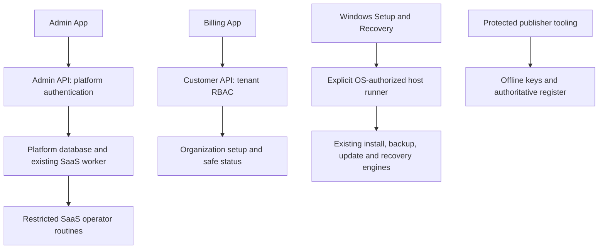

# System Setup & Operations Center

## Audit and proposed implementation plan

**Status: approved for implementation — batches 1–2 implemented for local development; batches 3–6 pending.**

Implemented progress and verification are recorded in
[review coverage](review-coverage.md); current diagnostic instructions are in
[Setup & system checks](setup-operations.md). Unchecked acceptance criteria and
later batches remain planned work, not completed functionality.

This document preserves the operational audit and implementation plan discussed
with the project owner. It covers the Admin App, Billing App, Windows host tools,
publisher tooling and SaaS operations. It does not authorize production changes,
replace existing runbooks or close outstanding commercial release requirements.

The audit was read-only: no application code, configuration, database, service,
certificate trust or signing material was changed. Existing implementation and
proposed improvements are distinguished throughout this document.

## Contents

1. [Summary and recommended interfaces](#1-summary-and-recommended-interfaces)
2. [Verified current capabilities and gaps](#2-verified-current-capabilities-and-gaps)
3. [Operation inventory](#3-operation-inventory)
   - [A. Environment and initial setup](#a-environment-and-initial-setup)
   - [B. Organization and account administration](#b-organization-and-account-administration)
   - [C. Offline Windows lifecycle](#c-offline-windows-lifecycle)
   - [D. Backups and recovery](#d-backups-and-recovery)
   - [E. SaaS deployment, diagnostics and maintenance](#e-saas-deployment-diagnostics-and-maintenance)
   - [F. Publisher and exceptional operations](#f-publisher-and-exceptional-operations)
4. [Recommended UI and UX](#4-recommended-ui-and-ux)
5. [Architecture and affected components](#5-architecture-and-affected-components)
6. [Security and failure handling](#6-security-and-failure-handling)
7. [Prioritized implementation roadmap](#7-prioritized-implementation-roadmap)
8. [Testing and acceptance criteria](#8-testing-and-acceptance-criteria)
9. [Operations that remain human-controlled](#9-operations-that-remain-human-controlled)
10. [External inputs, scope and verification limits](#10-external-inputs-scope-and-verification-limits)

## 1. Summary and recommended interfaces

The main problem is that useful operational code already exists, but using it
requires knowing which commands, files, credentials and steps belong together.
Build guided workflows around that code rather than replacing it with a new
management framework.

Use three coordinated interfaces:

| Interface                                | Purpose                                                                                                 |
| ---------------------------------------- | ------------------------------------------------------------------------------------------------------- |
| Admin App: System Setup & Operations     | Manage the central platform, SaaS connections, onboarding, commercial workflows and operational status. |
| Billing App: Workspace Setup & Status    | Help customers complete business setup and understand problems affecting their organization.            |
| Standalone Windows Setup & Recovery tool | Install and maintain an offline host, including when the Billing App or database cannot start.          |

Centralize the experience without combining these security domains. A central
portal cannot repair an unavailable local database, and it must not acquire
unrestricted control of disconnected customer installations.

**Recommended first implementation: roadmap batches 1 and 2.** These address
the setup failures and generic error messages already encountered and establish
the safety foundation for later interfaces.

## 2. Verified current capabilities and gaps

### Existing capabilities

These are verified existing capabilities, not proposed features:

- Separate billing and platform databases, authentication domains and development
  commands.
- Host commands for owner provisioning, restricted database permissions and
  recovery.
- Admin screens for organizations, agreements, payments, license requests/imports
  and SaaS operations.
- A database-backed SaaS worker with operation receipts and retry handling.
- Encrypted customer backups, restore verification, quarantined recovery
  preparation and controlled database switching.
- Offline installation, repair, preserving uninstall, certificate replacement and
  interruption-recovery code.
- Signed release verification, staging, bundle assembly and protected publisher
  signing tools.
- Existing notifications, error guidance and some links to corrective screens.

### Confirmed gaps

1. **Setup is fragmented.** Admin setup involves SQL, environment files, private
   JSON inputs and several commands. The environment generator handles the
   customer `.env`, not the complete admin setup. See
   [setup-env.mjs](../scripts/setup-env.mjs) and
   [the admin runbook](platform-admin.md).
2. **Configured does not always mean verified.** The admin `saasConnected` value
   means an operator pool was configured. It does not prove connectivity, correct
   permissions or the intended target. See the configuration endpoint in
   [controller.ts](../apps/admin-api/src/controller.ts).
3. **The Operations page covers a narrow scope.** Its worker handles provisioning,
   setup links, grants and write pauses, not installation, backup, restore or
   deployment jobs. See [operations.ts](../apps/admin-api/src/operations.ts).
4. **Licensing requires technical file handling.** Claims and predecessors are
   exported separately, and signed envelopes are pasted as JSON. See
   [LicensePanel.tsx](../apps/admin/src/LicensePanel.tsx).
5. **Some workflows lack a guided entry point.** Assisted updating has an existing
   coordinator and host adapters but remains a technical operator workflow. See
   [assisted-update.ts](../apps/api/src/operations/assisted-update.ts).
6. **Customer and platform recovery are different.** Customer backup tooling
   exists. Platform backup/restore has documentation and an integration drill,
   but lacks an equivalent finished production operating workflow. Do not treat
   these as interchangeable. See [customer recovery](backup-recovery.md) and
   [platform recovery](platform-admin.md#backups-restore-and-reconciliation).
7. **Documentation contains superseded descriptions.** Some older sections
   describe work as unfinished despite later implementation. Current instructions,
   historical evidence and remaining release gates need clearer separation.

## 3. Operation inventory

The inventory covers 51 operational tasks found in application entry points,
scripts, configurations and runbooks. Each proposed improvement remains pending.

### How to read the inventory

- **P0:** foundation or safety work.
- **P1:** core operating workflow.
- **P2:** later convenience or deployment-dependent work.
- **Release gate:** required human/external approval; not something the application
  can automatically declare complete.
- **S / M / L:** relative engineering effort, not delivery promises.
- Frequency is described for each group; recovery tasks are infrequent but have
  high consequences.

### A. Environment and initial setup

**Frequency:** first installation, new development environments and configuration
changes. Currently high friction despite being occasional.

#### A1 — Toolchain selection

- **Current:** select Node/pnpm manually; older terminals retain incompatible PATH
  values.
- **Proposed:** a developer setup assistant checks pinned versions and selects
  compatible tools. Commercial installers carry approved runtimes.
- **Dependencies and risks:** do not silently replace system tools or download
  unverified executables.
- **Priority / effort:** P0 / S.

#### A2 — Dependencies, shared builds and native modules

- **Current:** install dependencies, build shared packages and diagnose native
  module loading separately.
- **Proposed:** one guided developer preparation flow with a native cryptography
  check and clear failed-step reporting.
- **Dependencies and risks:** retain frozen dependencies and approved install
  scripts. Customer PCs must not build from source.
- **Priority / effort:** P0 / M.

#### A3 — Environment and credential configuration

- **Current:** copy/edit `.env`, `.env.admin` and operator files; manually encode
  passwords in URLs.
- **Proposed:** a protected setup assistant asks for individual fields, builds
  URLs correctly and validates complete profiles.
- **Dependencies and risks:** preserve existing credentials, comments and unknown
  settings; write atomically with correct ACLs.
- **Priority / effort:** P0 / M.

#### A4 — Edition and target selection

- **Current:** manually distinguish offline/SaaS, development/production and the
  target billing database.
- **Proposed:** explicit deployment profiles with a visible edition/database
  summary before changes.
- **Dependencies and risks:** never silently convert existing organizations or
  connect the portal to the wrong edition.
- **Priority / effort:** P0 / M.

#### A5 — PostgreSQL startup and connection prerequisites

- **Current:** start Docker/PostgreSQL and investigate daemon, port,
  authentication or retained-volume password problems.
- **Proposed:** developer launcher and host preflight identify the actual failed
  dependency.
- **Dependencies and risks:** never delete a volume, reset a password or stop an
  unrelated service as an automatic fix.
- **Priority / effort:** P0 / M.

#### A6 — Databases and restricted database roles

- **Current:** create platform databases and independent PostgreSQL roles through
  SQL.
- **Proposed:** a host setup workflow creates only explicitly approved new
  resources and records their identities.
- **Dependencies and risks:** use short-lived operator authority. Collisions need
  inspection, not adoption or replacement.
- **Priority / effort:** P0 / L.

#### A7 — Migrations and runtime permissions

- **Current:** run customer/admin migrations and grant runtime permissions
  separately.
- **Proposed:** inspect, show changes, apply reviewed migrations and verify runtime
  grants through one guided migration plan.
- **Dependencies and risks:** no startup migrations, schema push, edited migration
  history or migration credentials in web services.
- **Priority / effort:** P0 / L.

The platform migrator currently loads a single versioned SQL file. Adding
persistent operational tables requires an additive migration mechanism preserving
the existing checksum/history. See [store.ts](../apps/admin-api/src/store.ts).

#### A8 — Initial owner provisioning

- **Current:** create private owner-input files, invoke provisioning and inspect
  prepared/committed recovery output.
- **Proposed:** a protected owner-creation form in the host setup tool with a
  secure recovery-material handoff.
- **Dependencies and risks:** preserve the singleton platform owner, existing-user
  protections and durable recovery proof before commit.
- **Priority / effort:** P0 / M.

#### A9 — Connecting and enabling SaaS operations

- **Current:** configure SaaS operator credentials, grant routine access and
  manually enable processing.
- **Proposed:** guided connection verification followed by an explicit
  host-authorized enable step.
- **Dependencies and risks:** verify target identity, restricted routines and
  reconciliation state. Configuration alone cannot enable processing.
- **Priority / effort:** P0 / L.

#### A10 — Development startup and setup checks

- **Current:** start both app pairs and run diagnostic commands independently.
- **Proposed:** developer-only Start Billing, Start Admin and Check Setup actions.
- **Dependencies and risks:** preserve `pnpm dev` and `pnpm dev:admin`. Distinguish
  temporary development processes from installed services.
- **Priority / effort:** P1 / M.

### B. Organization and account administration

**Frequency:** daily administration or repeated for every customer.

#### B1 — Online organization creation and linking

- **Current:** create/link an organization, then inspect separate records and
  operations.
- **Proposed:** an Admin onboarding wizard with provisioning progress and a
  verified mapping summary.
- **Dependencies and risks:** reuse operation IDs and receipts; repeated clicks
  must not create another organization.
- **Priority / effort:** P1 / M.

#### B2 — Offline organization registration

- **Current:** obtain organization and installation UUIDs manually.
- **Proposed:** the local tool exports a small registration descriptor; Admin
  imports it into a preview form.
- **Dependencies and risks:** validate both identifiers. Imported information is
  not live activation evidence.
- **Priority / effort:** P1 / M.

#### B3 — Owner setup links

- **Current:** generate/share links and handle missing, expired or lost links
  manually.
- **Proposed:** one onboarding page showing provisioning, owner setup, expiry and
  explicit regeneration.
- **Dependencies and risks:** preserve 24-hour expiry, single use and invalidation
  of previous links. Never recover a lost token from logs.
- **Priority / effort:** P1 / M.

#### B4 — Billing workspace readiness

- **Current:** customers separately discover business details, GST applicability,
  catalog review and access prerequisites.
- **Proposed:** a Billing setup checklist linking directly to existing forms and
  showing precise blockers.
- **Dependencies and risks:** business facts and tax decisions remain
  human-entered/reviewed; no automatic compliance approval.
- **Priority / effort:** P1 / M.

#### B5 — Team access and normal account security

- **Current:** team roles, invitations, temporary passwords, MFA and device
  management use existing screens.
- **Proposed:** improve sequencing and completion guidance around those screens.
- **Dependencies and risks:** retain owner protection, delegation limits,
  invitation acceptance and mandatory MFA rules.
- **Priority / effort:** P1 / S.

#### B6 — Agreements, receipts and commercial corrections

- **Current:** agreements, receipts, adjustments and void/replacement entries
  require navigating several forms.
- **Proposed:** a guided commercial workflow showing balance and the next valid
  action.
- **Dependencies and risks:** retain exact paise, idempotency, financial history
  and explicit corrections. Payment must not change access automatically.
- **Priority / effort:** P1 / M.

#### B7 — License request preparation

- **Current:** prepare dates and review access effects through technical fields
  and confirmations.
- **Proposed:** a license wizard displaying the agreement, dates, timezone,
  predecessor and proposed access effect together.
- **Dependencies and risks:** preserve exact 14-day trials, sequences and explicit
  approval. Warn about future/expired grants replacing current access.
- **Priority / effort:** P1 / M.

#### B8 — External signing handoff

- **Current:** export claims and predecessor separately, then manage the external
  handoff manually.
- **Proposed:** export one validated request package with a human-readable summary
  and the required signing inputs.
- **Dependencies and risks:** the publisher register remains authoritative;
  private keys stay outside the portal.
- **Priority / effort:** P1 / M.

#### B9 — Signed grant import and SaaS application

- **Current:** paste JSON, select a request, import, apply and manually recheck
  status.
- **Proposed:** bounded file import, verified preview, explicit SaaS application
  and tracked result.
- **Dependencies and risks:** verify exact claims, history, edition and binding.
  Imported must remain distinct from applied.
- **Priority / effort:** P1 / M.

#### B10 — SaaS write pause and resume

- **Current:** pause/resume and infer the result through later refreshes.
- **Proposed:** show the requested operation, confirmed pause state, reason and
  last verification time together.
- **Dependencies and risks:** resume removes only the manual pause; licensing,
  RBAC and compliance still apply.
- **Priority / effort:** P1 / S.

#### B11 — Historical operation and commercial lookup

- **Current:** latest-entry limits and generic tables make older history
  difficult to inspect.
- **Proposed:** searchable, paginated operation/audit/commercial history with
  meaningful detail pages.
- **Dependencies and risks:** strict filters and authorization; no SQL console or
  raw sensitive payload browser.
- **Priority / effort:** P1 / M.

Lost-factor recovery and unsupported owner-profile changes are separate from
normal settings. They are covered in F4 and F5.

### C. Offline Windows lifecycle

**Frequency:** installation, occasional maintenance and emergencies.

#### C1 — Installation configuration and preflight

- **Current:** assemble a large private configuration containing paths, ports,
  origin, subnet and trust inputs.
- **Proposed:** a standalone Windows wizard detects safe candidates and validates
  a reviewable installation plan.
- **Dependencies and risks:** require approved signed inputs and an explicit
  target/root. Refuse foreign services, reparse paths and collisions.
- **Priority / effort:** P1 / L.

#### C2 — Windows backup identity

- **Current:** manually prepare an ordinary backup account, its SID and DPAPI
  credential file.
- **Proposed:** guided account selection/provisioning and secure credential
  capture.
- **Dependencies and risks:** never grant administrator rights; validate scheduler
  rights and protect credentials.
- **Priority / effort:** P1 / L.

#### C3 — Initial offline installation

- **Current:** run `offline:host install` from trusted operator tooling.
- **Proposed:** a signed launcher executes the existing engine and displays
  durable progress.
- **Dependencies and risks:** customers need no Node/pnpm/source checkout.
  Success follows actual service/readiness verification.
- **Priority / effort:** P1 / L.

#### C4 — LAN connection and client trust

- **Current:** configure hostname/network and run trust commands on each client.
- **Proposed:** a connection guide shows the exact address, certificate identity
  and an explicit client trust helper.
- **Dependencies and risks:** independent fingerprint verification and OS approval;
  no router reconfiguration or TLS-warning bypass.
- **Priority / effort:** P1 / L.

#### C5 — Local signed license installation

- **Current:** install a signed license using a terminal and operator connection.
- **Proposed:** a Local License action in the protected maintenance tool: choose
  file, preview, confirm and verify.
- **Dependencies and risks:** require local operator authorization. Tenant sessions
  do not obtain license-installation credentials.
- **Priority / effort:** P1 / M.

#### C6 — Offline assisted updates

- **Current:** check eligibility, verify/stage the release and invoke the update
  library through technical tooling.
- **Proposed:** Check package, Review eligibility, Schedule maintenance and Update
  in one guided workflow.
- **Dependencies and risks:** recheck active maintenance for every organization at
  execution. Signed packages and trusted migrations remain mandatory.
- **Priority / effort:** P1 / L.

#### C7 — Retained-data repair

- **Current:** prepare repair configuration and invoke repair manually.
- **Proposed:** Repair this installation using protected installed identity and
  matching approved artifacts.
- **Dependencies and risks:** never run `initdb`, reprovision owners or substitute
  a different version under repair.
- **Priority / effort:** P1 / L.

#### C8 — Data-preserving uninstall

- **Current:** run uninstall with confirmations and maintenance coordination.
- **Proposed:** a clear review showing registrations removed and data retained.
- **Dependencies and risks:** retain databases, backups, keys and recovery
  evidence; verify ownership and successful service stop.
- **Priority / effort:** P1 / M.

#### C9 — Interrupted-operation inspection and recovery

- **Current:** inspect locks, PIDs, fingerprints and journals before recovery.
- **Proposed:** an Interrupted operation screen showing evidence and only
  supported recovery choices.
- **Dependencies and risks:** no timeout-based lock stealing. Incomplete initial
  installations lacking sufficient evidence remain operator-review cases.
- **Priority / effort:** P0 / L.

Wrap the existing implementation rather than recreating it in React. See
[the lifecycle entry point](../apps/api/src/operations/offline-install-cli.ts)
and [installation boundaries](windows-installation.md).

### D. Backups and recovery

**Frequency:** periodic protection and verification, with infrequent high-risk
recovery operations.

#### D1 — Backup keys and recovery material

- **Current:** generate keys and preserve installation/MFA/configuration recovery
  material separately.
- **Proposed:** guided recovery-kit preparation with explicit storage
  acknowledgement and verification.
- **Dependencies and risks:** distinct keys retain distinct purposes. Never
  regenerate a lost key as a repair.
- **Priority / effort:** P0 / M.

#### D2 — Backup jobs and schedules

- **Current:** supply many job arguments and separately configure scheduled
  execution.
- **Proposed:** one host backup profile with Run verified backup and schedule
  controls.
- **Dependencies and risks:** reuse the existing job lock, installed-release
  pointer, restricted account and restore verification.
- **Priority / effort:** P1 / L.

#### D3 — Backup health monitoring

- **Current:** run `backup:health` or inspect job files and logs.
- **Proposed:** display last attempt, last verified restore, age and an actionable
  failure reason.
- **Dependencies and risks:** an unverified archive, missing file or incompatible
  schema cannot be reported as successful protection.
- **Priority / effort:** P1 / M.

#### D4 — Off-device copies and retention

- **Current:** copy backups and manage retention manually; automatic pruning is
  absent.
- **Proposed:** guided encrypted export, followed later by policy-controlled
  copying and retention.
- **Dependencies and risks:** destination, retention and failure policy require
  explicit decisions. Preserve verified recovery coverage.
- **Priority / effort:** P1 / L.

#### D5 — Quarantined recovery preparation

- **Current:** verify a backup, prepare a copy, optionally migrate it and provision
  grants through separate commands.
- **Proposed:** a Recovery preparation wizard combines those stages with
  checkpoints.
- **Dependencies and risks:** require a trusted archive, correct key/installation,
  compatible schema and isolated restore target.
- **Priority / effort:** P1 / L.

#### D6 — Recovery activation and rollback

- **Current:** stop writers, activate, validate and potentially roll back manually.
- **Proposed:** a host-only cutover review showing the recovery point, retained
  database and resulting state.
- **Dependencies and risks:** inspect actual database identities after uncertain
  commits. Rollback requires explicit data-loss acknowledgement.
- **Priority / effort:** P0 / L.

#### D7 — Platform database backup and restore

- **Current:** a documented procedure backed by an integration drill.
- **Proposed:** build a platform-specific backup/restore runner before exposing
  its safe status/workflow.
- **Dependencies and risks:** separate platform identity/migration checks; revoke
  restored sessions and quarantine its worker before startup.
- **Priority / effort:** P0 / L.

#### D8 — Reconciliation after restoration

- **Current:** reconcile portal history with SaaS receipts and the publisher
  register manually.
- **Proposed:** a guided report highlighting discrepancies and outstanding
  decisions.
- **Dependencies and risks:** never automatically roll back SaaS, reset issuer
  history or reissue a grant to make records match.
- **Priority / effort:** P0 / L.

#### D9 — Retained artifacts and safe cleanup

- **Current:** track abandoned candidates, plaintext workspaces and retained
  copies manually.
- **Proposed:** inventory owned artifacts and offer scoped cleanup after review.
- **Dependencies and risks:** delete only proven-owned, unreferenced resources;
  retain unresolved evidence and required recovery copies.
- **Priority / effort:** P2 / M.

Preserve the existing customer engine's checks. See
[backup-operator.ts](../packages/database/src/backup-operator.ts) and
[recovery-switch.ts](../packages/database/src/recovery-switch.ts).

### E. SaaS deployment, diagnostics and maintenance

**Frequency:** deployment, regular health checks and occasional infrastructure
maintenance. Provider-specific automation depends on a selected environment.

#### E1 — SaaS infrastructure preparation

- **Current:** choose infrastructure and prepare DNS/TLS, secrets and process
  supervision manually.
- **Proposed:** a deployment checklist and reproducible recipe for the selected
  provider.
- **Dependencies and risks:** provider selection and real credentials are external
  inputs. Do not build a speculative infrastructure control panel.
- **Priority / effort:** P1 / L.

#### E2 — Controlled SaaS deployment and schema changes

- **Current:** builds, deployment, migrations, permission changes and readiness
  checks are separate procedures.
- **Proposed:** a deployment job with preflight, backup, compatibility checks and
  post-deployment validation.
- **Dependencies and risks:** separate deployment identity; no migration
  credentials in running APIs or assumed safe schema downgrade.
- **Priority / effort:** P1 / L.

#### E3 — Certificate validation and expiry visibility

- **Current:** customer TLS expiry is logged; equivalent admin checks/monitoring
  are not wired the same way.
- **Proposed:** consistent validation/status for both APIs and operator-visible
  expiry notices.
- **Dependencies and risks:** report the loaded certificate, not merely the file
  on disk; authenticated detail only.
- **Priority / effort:** P1 / M.

#### E4 — Certificate issuance, replacement and recovery

- **Current:** obtain certificates/CSRs, prepare complex replacement configuration
  and restart/recover manually.
- **Proposed:** guided certificate handoff and replacement using the existing
  controlled workflow.
- **Dependencies and risks:** require issuer selection, approved trust and a valid
  replacement. CA keys stay outside running applications.
- **Priority / effort:** P1 / L.

#### E5 — Configuration and credential maintenance

- **Current:** edit environment files/credentials and manually coordinate
  dependent services and jobs.
- **Proposed:** restricted maintenance with a validated change preview and restart
  plan.
- **Dependencies and risks:** no generic environment editor. Password/key rotation
  needs its own tested migration and recovery procedure.
- **Priority / effort:** P2 / L.

#### E6 — Diagnostics and support information

- **Current:** diagnose generic CLI/startup/connection failures and collect
  information manually.
- **Proposed:** structured Check Setup / Diagnose results and an explicitly
  generated redacted support package.
- **Dependencies and risks:** work when the API is down; omit secrets, setup tokens
  and customer records. No arbitrary network probes.
- **Priority / effort:** P0 / M.

The existing [CI workflow](../.github/workflows/ci.yml) verifies builds/tests; it
is not a production deployment pipeline.

### F. Publisher and exceptional operations

**Frequency:** publisher releases, authority changes and exceptional recovery.
These are deliberately restricted, not normal customer actions.

#### F1 — Vendor and redistribution review

- **Current:** review archives, hashes, dependencies, notices and approval receipts
  manually.
- **Proposed:** generate a review package and show approval gaps before assembly.
- **Dependencies and risks:** human redistribution approval remains required. A
  downloaded hash cannot approve itself.
- **Priority / effort:** release gate / M.

#### F2 — Release assembly and signing

- **Current:** prepare, smoke, sign, seal and verify related artifacts manually.
- **Proposed:** one publisher release workflow with checkpoints and immutable
  outputs.
- **Dependencies and risks:** separate Authenticode and Ed25519 signatures. Changed
  content requires a new candidate.
- **Priority / effort:** P1 / L.

#### F3 — Issuer authority and committed-grant export

- **Current:** initialize/protect the register, unlock keys, issue and recover
  failed deliveries through several commands.
- **Proposed:** a guided publisher-only signing/export workflow using the existing
  authoritative register.
- **Dependencies and risks:** signing remains outside the portal. Delivery failure
  exports the committed grant rather than issuing again.
- **Priority / effort:** P1 / M.

#### F4 — Protected-owner recovery

- **Current:** recover platform/offline owners through private files and host
  commands.
- **Proposed:** a host-authorized form requiring the existing one-time proof and
  secure replacement handoff.
- **Dependencies and risks:** revoke sessions/factors as defined. SaaS loss of all
  factors still needs a separately approved identity-verification policy.
- **Priority / effort:** P1 / L.

#### F5 — Owner identity changes and hardware transfers

- **Current:** complete self-service workflows do not exist, which can lead users
  to attempt unsupported database/file edits.
- **Proposed:** explicit supported procedures; add narrow audited profile
  maintenance only if needed.
- **Dependencies and risks:** no account-table edits, owner impersonation, guessed
  installation IDs or promised immediate offline revocation.
- **Priority / effort:** P2 / M–L.

#### F6 — Developer resets, prototypes and acceptance instructions

- **Current:** development resets, quality checks, prototype instructions and
  release acceptance are mixed across documents.
- **Proposed:** one current developer runbook, safe disposable profiles and a
  separate commercial acceptance checklist.
- **Dependencies and risks:** no production wipe-database button. Never delete a
  shared PostgreSQL volume to reset one application.
- **Priority / effort:** P0 / M.

## 4. Recommended UI and UX

### Admin App: System Setup & Operations

Extend the existing Operations area rather than adding a separate management
website.

| Section            | What the platform owner sees                                                                                       |
| ------------------ | ------------------------------------------------------------------------------------------------------------------ |
| Overview           | Verified environment, configured connections, worker status, backup health and items requiring attention.          |
| Setup              | A resumable checklist for database readiness, restricted connections, owner security and deployment prerequisites. |
| Operations         | Pending/running/completed work, attempts, confirmed outcomes and safe next actions.                                |
| Backups & Recovery | Available evidence, verification results, recovery requests and clearly restricted host actions.                   |
| Diagnostics        | Named checks, corrective guidance, timestamps and redacted support export.                                         |

Each problem should explain the failure, impact, available functions and next
action. For example:

> **What failed:** Billing database authentication failed.  
> **What is affected:** New organization provisioning is waiting.  
> **What remains available:** Your organization directory and commercial records.  
> **Next action:** Open the protected connection setup workflow.  
> **Retry rule:** Recheck this operation; do not create the organization again.

Configured, verified, stale and unavailable must be different states. A stored
connection string or old successful observation is insufficient for a green
status.

### Billing App: Workspace Setup & Status

Add a compact checklist:

1. Account and required security complete.
2. Business details and GST registration complete.
3. E-invoice applicability assessed.
4. Customer and catalog records prepared.
5. Applicable classifications reviewed.
6. License permits business writes.
7. Supported invoice scope ready.

Show only information authorized for that organization. Whole-server backups,
credentials and other organizations remain inaccessible.

Keep personal security and appearance in the existing account modal. Do not
recreate them in a second settings screen.

### Standalone Windows Setup & Recovery

A signed application should provide:

- Install.
- Check installation.
- Import license.
- Backup.
- Update.
- Replace certificate.
- Repair.
- Recover an interrupted operation.
- Uninstall while retaining data.

It must remain usable when the Billing App, API or PostgreSQL is unavailable.
Use a thin Windows-native shell around the existing operational engine. Avoid
Electron or another full application runtime merely to display setup forms.
Request Windows elevation only for actions requiring it.

## 5. Architecture and affected components

### Separate authorities

There is deliberately no Admin-to-offline-host remote-control connection.

### Affected components

| Component                | Proposed change                                                                                                          |
| ------------------------ | ------------------------------------------------------------------------------------------------------------------------ |
| `packages/contracts`     | Strict diagnostic, prerequisite, progress and safe-result contracts; no OS or database secrets.                          |
| `apps/admin-api`         | Verified setup/status endpoints, onboarding summaries, better operational detail and additive migrations where required. |
| `apps/admin`             | Operations Center, guided onboarding, bounded file imports and operation detail URLs.                                    |
| `apps/api`               | Organization readiness/status responses and reusable sanitized operational errors.                                       |
| `apps/web`               | Setup checklist and contextual corrective actions using existing forms.                                                  |
| `packages/database`      | Reuse customer recovery functions; add the separate platform backup/restore adapter where needed.                        |
| `apps/windows-installer` | Thin launcher, typed host runner, progress reporting and approved recovery entry points.                                 |
| `scripts/issuer`         | Consolidated publisher workflow and request-package handoff, retaining external signing authority.                       |
| CI and runbooks          | Reproducible deployment/acceptance procedures and removal of misleading current instructions.                            |

### Implementation rules

- Call existing typed functions where possible. Do not shell out to `pnpm` from
  a web request.
- Preserve CLI interfaces for headless operators and existing automation.
- Keep customer-runtime, platform-runtime, deployment and signing credentials
  separate.
- Keep host journals outside the application database so recovery remains
  possible during database failure.
- Map existing journals and receipts into common UI labels. Do not replace their
  formats with a generic workflow engine.
- Add persistent job storage only for genuinely new asynchronous jobs. Keep the
  current SaaS receipt mechanism for existing operations.
- No Redis, message broker, new server or workflow framework is justified by the
  current scope.
- For a Windows helper, use explicit IPC permissions and peer verification.
  Default named-pipe permissions are unsuitable for sensitive operation payloads.
  See [Microsoft named-pipe security](https://learn.microsoft.com/en-us/windows/win32/ipc/named-pipe-security-and-access-rights).

## 6. Security and failure handling

### Authorization

| Actor                    | Permitted scope                                                               |
| ------------------------ | ----------------------------------------------------------------------------- |
| Billing employee         | Authorized organization functions and limited status explanations.            |
| Organization owner       | Business setup and existing organization/security administration.             |
| Platform owner           | Existing platform commercial/onboarding/license operations, protected by MFA. |
| Host/deployment operator | Explicit infrastructure operations through separate OS/deployment authority.  |
| Publisher signer         | Protected external signing and register operations.                           |

A platform session does not automatically grant Windows administrator access or
access to signing keys. New controls deny access unless explicitly authorized,
with authorization checked again at execution. See
[OWASP authorization guidance](https://cheatsheetseries.owasp.org/cheatsheets/Authorization_Cheat_Sheet.html).

### Execution safety

- Accept fixed operation types and validated inputs. Never accept commands,
  scripts, executable paths or SQL supplied by a browser.
- Prefer library functions. If native tools are required, use approved binaries
  and structured arguments. See
  [OWASP command-injection guidance](https://cheatsheetseries.owasp.org/cheatsheets/OS_Command_Injection_Defense_Cheat_Sheet.html).
- Bind approval to the actual target, operation and proposed change. Changed
  inputs invalidate approval. See
  [OWASP transaction authorization](https://cheatsheetseries.owasp.org/cheatsheets/Transaction_Authorization_Cheat_Sheet.html).
- Keep passwords and keys out of command arguments, logs, telemetry and
  downloadable diagnostics.
- Treat support exports as an allowlisted data format, not a dump of logs and
  environment variables.
- Preserve audit history and record requested and verified outcomes separately.

### Failure behaviour

| Scenario                                                       | Required behaviour                                                                                                                |
| -------------------------------------------------------------- | --------------------------------------------------------------------------------------------------------------------------------- |
| Browser closes or request times out                            | Continue or safely stop according to the operation's phase. Reopening retrieves its existing ID. Timeout is not proof of failure. |
| Commit reply is lost                                           | Reconcile receipts or database identities before retrying.                                                                        |
| Two operators start maintenance                                | Existing installation locks reject the second operation.                                                                          |
| Process crashes                                                | Preserve durable intent and show inspection/recovery; never clear locks by age.                                                   |
| Disk fills or backup verification fails                        | Do not proceed to cutover/update or report successful protection.                                                                 |
| Database/API cannot start                                      | Standalone diagnostics and recovery remain available.                                                                             |
| Restored platform database contains an old enabled-worker flag | Hold processing behind a recovery/deployment guard until reconciliation is explicitly completed.                                  |
| Restored database contains sessions                            | Revoke restored sessions before admitting users under the approved recovery procedure.                                            |
| Key, identity receipt or required artifact is missing          | Block; do not generate replacement identity or guess ownership.                                                                   |
| License or clock changes during an update                      | Recheck eligibility at the existing protected execution points.                                                                   |
| Users wrote after recovery activation                          | Rollback requires an explicit recovery-point decision. Do not silently discard or merge those writes.                             |

Cancellation is phase-aware. **Closing a progress window cannot mean killing a
migration or undoing a committed operation.**

## 7. Prioritized implementation roadmap

These are six bounded delivery batches, not additional open-ended product phases.
The batches below define the approved scope. Diagnostics and guided local setup are implemented;
later batches and unchecked acceptance criteria remain pending.

### Batch 1 — Operational diagnostics foundation

**Implemented:** read-only Admin Operations checks, strict diagnostic contracts,
safe codes/guidance, a local `setup:check` command and a current setup runbook.
See [review coverage](review-coverage.md) for verified checks and limitations.

**Deliver:** safe error codes, verified status, prerequisite models and a current
runbook structure.

**Complete when:** incompatible tools, wrong edition/target, missing migrations,
bad permissions, a disabled worker and connectivity failures can be distinguished
without leaking secrets.

### Batch 2 — Guided initial setup

**Implemented for new local development profiles:** pinned preparation launcher,
hidden interactive input, protected environment/recovery files, new database and
role creation, reviewed migrations/permissions, durable initial-owner provisioning,
safe reruns, explicit empty-installation worker enablement and runtime-only daily
launch. See [guided setup](guided-setup.md). Existing installations retain their
reviewed host procedures; production hosting and the Windows installer remain
within the existing later batches and external release gates.

**Deliver:** developer preparation assistant and protected platform/billing
bootstrap workflows.

**Complete when:** fresh setup needs no hand-written SQL or password JSON in the
normal supported path. Reruns preserve existing resources and secrets.

### Batch 3 — Daily administration UX

**Deliver:** onboarding wizard, setup checklist, file-based license handoff/import
and useful operation details.

Implemented scope (2026-11-08): two-step organization review with offline
descriptor import, hosted-owner progress, permission-scoped Billing checklist,
complete commercial balance/step guidance, single-package external signing,
bounded signed-file import, and filtered/paginated operation lists with stable
details and retry guidance. See [daily workflows](daily-workflows.md) and
[review coverage](review-coverage.md) for usage and verification evidence.
Existing signing, MFA, onboarding and commercial mutation services remain the
authority. Inventory B11's broader audit/commercial-history pagination is not
implemented: those tables retain their existing recent-record limits; the new
complete balance is not computed from those limited tables.

**Complete when:** users can onboard an organization and understand each pending
access step without searching several runbooks or guessing at JSON.

### Batch 4 — Backup and recovery operations

**Deliver:** backup profiles/status, platform-specific tooling, guided recovery
and reconciliation.

Implementation (2026-11-08): protected host profiles, fixed backup/verify/recovery
actions, immutable job evidence, sanitized read-only Admin status, encrypted
off-device export, a platform-specific restore/quarantine adapter, guided existing
Billing cutover/rollback, bounded platform receipt/grant reconciliation and owned
artifact inventory. See [guided backup and recovery](guided-backup-recovery.md)
and [review coverage](review-coverage.md). No privileged browser executor was
introduced. Platform live cutover/authority re-enablement remains a reviewed host
procedure; retention/deletion policy, actual scheduler deployment/alerting and
real Windows acceptance are not assumed complete by local verification.

**Complete when:** verified backups and isolated restores work. Cutover and
rollback preserve evidence and require the correct authority/approvals.

### Batch 5 — Windows lifecycle interface

**VM acceptance postponed again (2026-11-12, owner decision):** temporary use of
one VM was considered acceptable, but setup/testing is deferred for now. The
hardware observations, internal-signing boundary and exact resume steps are in
[Windows VM testing](windows-vm-testing.md). Do not treat this as a waived gate.

Local engineering (2026-11-12): native .NET Framework launcher, protected isolated
maintenance runtime and publisher assembly, fixed host facade, guided
installation/owner/credential inputs, signed license import, owned scheduled
backup, update/certificate/repair/preserving-uninstall and existing interrupted
recovery paths are connected. See [Windows maintenance](windows-maintenance.md)
and [review coverage](review-coverage.md). The launcher requires real Authenticode
trust and its pinned publisher before executing host actions. Production signing
and the postponed disposable host/client acceptance remain open; the batch's
commercial completion criterion below is not yet satisfied.

Follow-up guidance completion: installation suggests a new standard folder,
observed unused ports and an unambiguous private interface/subnet; all inputs
remain editable and are rechecked by strict preflight. Backup preparation guides
Windows standard-account creation/selection and verifies effective batch-logon
rights before saving protected credentials, without changing policy. A connection
guide presents the saved address with configured public certificate identity and
client CA instructions. These local additions do not waive signing or native
acceptance gates.

**Deliver:** a signed launcher around installation, licensing, updates,
certificates, repair and preserving uninstall.

**Complete when:** supported workflows need no customer terminal commands and
real Windows acceptance passes before commercial release.

### Batch 6 — Provider-bound SaaS operations

**Deliver:** selected-provider deployment, supervision, backup/alerting and
certificate-renewal integration.

**Complete when:** a real deployment and provider restore drill pass with
restricted credentials and monitored failures.

### Execution method for every batch

1. Define the permitted operation and its failure states.
2. Reuse or complete its backend implementation.
3. Test the backend boundary.
4. Add the guided interface.
5. Run integration/browser regressions.
6. Record completion evidence and remaining external dependencies.

Start with batches 1 and 2. They address the observed setup failures and generic
errors before exposing more operational controls.

## 8. Testing and acceptance criteria

The following are whole-plan acceptance requirements. An unchecked item is not a
claim of completed functionality. Executed batch checks and their limits are
recorded in [review coverage](review-coverage.md).

### Setup and configuration

- [ ] Fresh and existing environments both work.
- [ ] Reserved URL characters in passwords need no manual encoding.
- [ ] Incompatible Node/pnpm versions produce a precise prerequisite failure.
- [ ] Repeated setup does not overwrite secrets, recreate owners or adopt
      unrelated roles/services.
- [ ] Wrong database, edition, origin or runtime permissions are detected before
      mutation.
- [ ] Failure after owner creation but before its response does not create another
      owner or lose recovery material.

### Authorization and isolation

- [ ] Customer cookies cannot access platform or host operations.
- [ ] Platform authentication cannot impersonate a customer.
- [ ] Tenant owners cannot restore or download shared database backups.
- [ ] Browser inputs cannot select arbitrary commands, paths, hosts or database
      targets.
- [ ] Revoked sessions and stale approvals fail at execution.
- [ ] Diagnostics/artifacts contain no passwords, tokens, private keys or customer
      business records.

### Business and commercial workflows

- [ ] Existing-user onboarding cannot replace passwords or bypass invitation/MFA
      requirements.
- [ ] Setup-link expiry, replay and regeneration remain correct.
- [ ] Payment records never automatically activate, sign or revoke licenses.
- [ ] Forged, conflicting, stale and wrongly bound grants fail.
- [ ] Future grants, expiry and pause/resume show their true effects.
- [ ] Tax review, IRP and issuance restrictions remain independent of setup
      completion and licensing.

### Asynchronous operations and recovery

- [ ] Duplicate submissions, concurrent workers, restarts and lost responses do
      not duplicate committed work.
- [ ] Refresh and Back/Forward reopen the correct operation.
- [ ] Unknown outcomes remain visibly unresolved until reconciled.
- [ ] Restore verification checks archive identity, schema, financial integrity and
      restricted runtime access.
- [ ] Platform restore keeps processing quarantined until reconciliation.
- [ ] Failed updates retain original application/database copies and cannot
      silently downgrade schema.

### Windows and deployment

- [ ] Test actual services, ACLs, scheduled credentials, certificate trust, reboot,
      LAN access and internet-disconnected operation.
- [ ] Test disk-full conditions, interrupted installation, expired certificates,
      missing keys and failed admission.
- [ ] Verify preserving uninstall and retained-data repair.
- [ ] Test compatibility with an unrelated PostgreSQL installation.
- [ ] Prove customer distributions exclude admin applications, publisher tooling
      and private credentials.
- [ ] Preserve existing unit, integration, browser, issuer and packaging
      regressions.

## 9. Operations that remain human-controlled

Some decisions can be guided, but cannot safely be replaced with automatic
approval:

- Vendor redistribution approval and publisher identity verification.
- Unlocking and using offline signing authority.
- Approving trust changes or installing a private CA.
- Choosing a disaster-recovery point or accepting rollback data loss.
- Reconciling an older restored publisher register or platform database.
- Protected-owner recovery when normal authentication is unavailable.
- Tax classification review and truthful e-invoice applicability.
- Hardware-transfer approval and recovery of disconnected installations.
- Production data destruction.
- Physical off-device custody and verification of recovery material.

The system can prepare evidence, validate inputs, explain consequences and execute
approved steps. It cannot legitimately invent missing approval, custody or
identity evidence.

## 10. External inputs, scope and verification limits

### Inputs still needed

- SaaS hosting provider and deployment environment.
- Backup retention, destination and failure/alerting policy.
- Approved certificate issuer and renewal/trust process.
- Prepared protected signing storage, production credentials and vendor approval.
- Suitable disposable Windows host and separate client for real acceptance tests.
- A separately reviewed SaaS recovery policy for users who lose every factor.

Real Windows testing remains postponed until suitable machines are available.
Do not alter the development laptop's services or trust store to substitute for
that environment.

### Preserved scope and business rules

- Billing/platform authentication and runtime privileges remain separate.
- Signing keys remain outside the portal and customer distributions.
- Time-limited expiry immediately makes business writes read-only.
- Perpetual maintenance expiry does not terminate existing billing rights.
- Payments, commercial agreements, signed grants and actual installation remain
  distinct states.
- Licensing does not bypass RBAC, tax review, IRP or issuance restrictions.
- Offline installations do not gain promised remote control, synchronization or
  immediate revocation.
- No unrestricted terminal, SQL console, generic environment editor or arbitrary
  infrastructure executor is exposed through the UI.
- No payment gateway, broader billing feature set or generic workflow framework
  is introduced by this plan.

### Verification limits

The operational audit reviewed source, entry points, configuration examples and
runbooks. It did not inspect private environment secrets, perform production
deployment or execute new installation, migration, backup, restore or test
commands. Previous engineering evidence remains in
[project-audit.md](project-audit.md) and
[review-coverage.md](review-coverage.md); it does not prove the new workflows in
this document exist.

The intended result is fewer manual steps and clearer ownership of each
operation, while retaining the existing security and recovery checks.
